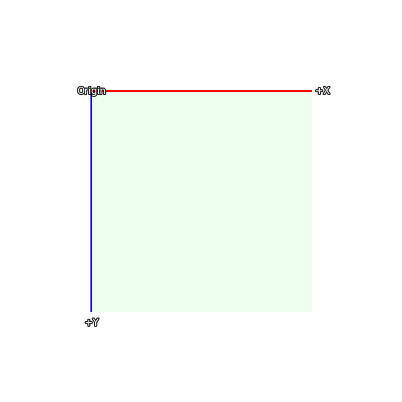
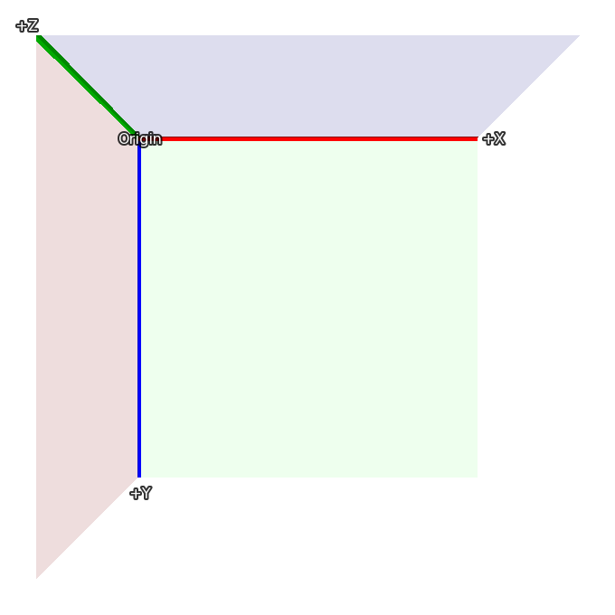
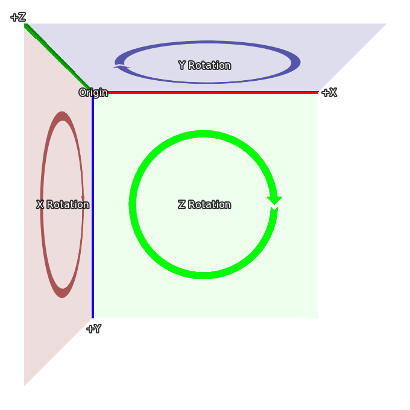

.. _3dstage:

========
3D-сцена
========

3D-сцена (3D Stage), названная по аналогии с театральными подмостками, — это концепция,
позволяющая позиционировать отображаемые объекты в трёх измерениях. Ren'Py визуализирует
их с правильной перспективой и предоставляет третью координату Z, что открывает возможности
для реализации реалистичного освещения, глубины резкости и трёхмерных перемещений.

Координаты
----------

Наиболее важная концепция 3D-сцены — система координат, используемая Ren'Py для трёхмерного пространства.
Ниже представлена система координат для двухмерного размещения отображаемых объектов:

В двухмерном режиме прямоугольник соответствует размерам экрана, а ширина и высота видимой области
задаются функцией :func:`gui.init` (обычно при первоначальном создании проекта).

3D-сцена расширяет эту систему новой осью Z, направленной в сторону зрителя: значения больше 0
приближают изображение к зрителю (делая его крупнее), а значения меньше 0 отдаляют его в глубину сцены
(уменьшая размер).

Вращение в трёхмерном пространстве осуществляется в следующих направлениях:

* При вращении вокруг оси Z ось X движется к оси Y.
* При вращении вокруг оси X ось Y движется к оси Z.
* При вращении вокруг оси Y ось Z движется к оси X.

Эти системы координат основаны на стандартных соглашениях Ren'Py, что облегчает переход
от 2D к 3D-сцене. При импорте трёхмерных моделей могут применяться преобразования координат
для корректной ориентации объектов.

Камера
------

Начальное положение камеры определяется параметрами функции :func:`gui.init`. Сначала Ren'Py
использует ширину `width` и угол обзора `fov` для расчёта расстояния по умолчанию по оси `z`.
При значении `fov` по умолчанию, равном 75:

* При width = 1280 расстояние z составляет приблизительно 834
* При width = 1920 расстояние z составляет приблизительно 1251
* При width = 3840 расстояние z составляет приблизительно 2502

Реальное значение z менее чем на единицу превышает указанные числа. Расстояние по умолчанию
можно переопределить с помощью свойства стиля :tpref:`perspective` или переменной
:var:`config.perspective`.

Ren'Py автоматически смещает камеру на вектор (`width` / 2, `height` / 2, `z`), направляя её взгляд
вдоль отрицательного направления оси -Z.

Расстояние `z` также является расстоянием от камеры до плоскости 1:1, где пиксели на экране имеют
тот же размер, что и в исходных изображениях (без учёта масштабирования окна). Увеличение позиции
камеры по z уменьшает все объекты на экране, а уменьшение — увеличивает.

Параметры :tpref:`perspective` и :var:`config.perspective` также задают ближнюю и дальнюю плоскости
отсечения (near и far planes), по умолчанию равные соответственно 100 и 100000. Это означает,
что если изображение окажется ближе 100 единиц z к камере или дальше 100 000 единиц z, оно перестанет
отображаться.

.. var:: config.perspective = (100, z, 100000)

    Значение по умолчанию, используемое, когда свойство :tpref:`perspective` не задано кортежем из 3 элементов.
    Параметр ``z`` зависит от исходного разрешения игры, как описано выше.

Использование 3D-сцены
----------------------

Первый шаг к использованию 3D-сцены — включение её для слоя с помощью оператора ``camera``.
Если имя слоя не указано, по умолчанию используется слой ``master``::

    # Включение 3D-сцены для слоя master.
    camera:
        perspective True

Хотя при необходимости можно сразу задать исходное положение камеры, как описано ниже.

Также можно явно указать имя слоя, чтобы включить 3D-сцену только для него::

    # Включение 3D-сцены для фонового слоя background.
    camera background:
        perspective True

Отображение изображений (фонов и спрайтов) выполняется точно так же, как и в 2D::

    scene bg washington

    show lucy mad at right

    show eileen happy

Однако теперь к этим объектам можно применять трансформации для перемещения в трёхмерном пространстве::

    scene bg washington:
        xalign 0.5 yalign 1.0 zpos -1000

    show lucy mad:
        xalign 1.0 yalign 1.0 zpos 100

    show eileen happy:
        xalign 0.5 yalign 1.0 zpos 200

Поскольку задана явная трансформация ATL, стандартная трансформация не применяется, и необходимо
указать :tpref:`xalign` и :tpref:`yalign` для позиционирования по осям X и Y. Разумеется, можно
использовать именованные трансформации::

    transform zbg:
        zpos -100

    transform z100:
        zpos 100

    transform z200:
        zpos 200

    scene bg washington at center, zbg

    show lucy mad at right, z100

    show eileen happy at center, z200

Если вы запустите этот пример, то заметите пустое пространство вокруг фона. При отдалении назад
(отрицательный zpos) фон уменьшается в размерах и перестаёт заполнять весь экран. Для решения этой
проблемы в Ren'Py предусмотрено свойство :tpref:`zzoom`. Установка :tpref:`zzoom True` автоматически
компенсирует перспективное сжатие, масштабируя изображение так, чтобы оно снова заполнило экран.
Это особенно удобно для фонов::

    transform zbg:
        zpos -100 zzoom True

Координату zpos можно плавно изменять в блоках ATL, как xpos и ypos::

    show eileen happy at center:
        zpos 0
        linear 4.0 zpos 200

Обратите внимание: координата zpos может неожиданным образом взаимодействовать с позициями вроде
``left`` и ``right``, а также :propref:`xalign` и :propref:`yalign`. Ren'Py сначала позиционирует
объекты в трёхмерном параллелепипеде сцены, а затем применяет перспективную проекцию, из-за чего
края объектов могут сместиться за границы экрана.

Камеру также можно анимировать с помощью оператора ``camera``::

    camera:
        perspective True
        xpos 0
        linear 3.0 xpos 500

При таком панорамировании камеры рекомендуется использовать фоновые изображения большего разрешения,
чем окно игры.

Если вы задаёте zpos спрайту, но положение не меняется, скорее всего, вы забыли включить клаузу
``perspective True`` для оператора ``camera``.

Камеру можно вращать::

    camera:
        perspective True
        rotate 45

Поскольку вращается сама камера, визуальный поворот сцены происходит в противоположном направлении
по сравнению с вращением отдельного объекта.

Глубина сцены
-------------

По умолчанию Ren'Py выводит изображения в обычном порядке добавления на слой: более позднее
изображение перекрывает более ранние. Это может приводить к странным эффектам, когда более близкий
к камере объект оказывается позади далёкого объекта.

Чтобы сортировать объекты автоматически по глубине с помощью буфера глубины видеокарты, включите
свойство :tpref:`gl_depth`::

    camera:
        perspective True
        gl_depth True

Небольшие погрешности округления могут приводить к мерцанию объектов, находящихся на строго одинаковой
глубине. Объединение таких изображений в один плоский слой или разнесение по z решает эту проблему.

Матричные трансформации
-----------------------

Ren'Py использует свойство трансформации :tpref:`matrixtransform` для применения матриц
к отображаемым объектам, что позволяет масштабировать, смещать и вращать изображение
в трёхмерном пространстве. Свойство принимает объект :func:`Matrix` или TransformMatrix
и применяет его к вершинам четырёхугольника выводимого изображения.

Свойство трансформации :tpref:`matrixanchor` упрощает позиционирование точки преобразования.
По умолчанию оно равно (0.5, 0.5) (центр изображения).

Ren'Py сначала сдвигает изображение так, чтобы точка привязки matrixanchor оказалась в (0, 0, 0),
затем применяет матричную трансформацию и возвращает изображение обратно на исходную величину сдвига.
По умолчанию трансформация применяется относительно центра спрайта.

Например::

    show eileen happy at center:
        matrixtransform RotateMatrix(45, 0, 0)

повернёт изображение вокруг горизонтальной линии, проходящей через его центр: верхняя часть
изображения уйдёт назад вглубь экрана, а нижняя выдвинется вперёд.

Матрицы можно объединять умножением (применяются справа налево)::

    show eileen happy at center:
        matrixtransform RotateMatrix(45, 0, 0) * OffsetMatrix(0, -300, 0)

Изображение сначала сместится вверх на 300 пикселей, а затем повернётся вокруг оси X.

Структурное сходство
^^^^^^^^^^^^^^^^^^^^

В языке ATL для интерполяции свойства :tpref:`matrixtransform` требуется, чтобы матрицы
TransformMatrix обладали структурным сходством — одинаковые типы матриц, перемноженные
в одном и том же порядке::

    show eileen happy at center:
        matrixtransform RotateMatrix(0, 0, 0) * OffsetMatrix(0, 0, 0)
        linear 2.0 matrixtransform RotateMatrix(45, 0, 0) * OffsetMatrix(0, -300, 0)
        linear 2.0 matrixtransform RotateMatrix(0, 0, 0) * OffsetMatrix(0, 0, 0)

TransformMatrix
---------------

TransformMatrix — базовый класс, экземпляры которого возвращают объекты Matrix. TransformMatrix
глубоко интегрирован с ATL и обеспечивает интерполяцию для matrixtransform::

    transform xrotate:
        matrixtransform RotateMatrix(0.0, 0.0, 0.0)
        linear 4.0 matrixtransform RotateMatrix(360.0, 0.0, 0.0)
        repeat

Подклассы TransformMatrix реализуют метод ``__call__(self, other, done)``, где `other` — старый объект,
а `done` — прогресс от 0.0 до 1.0.

Встроенные подклассы TransformMatrix
------------------------------------

.. seealso:: Класс :class:`SplineMatrix`, поддерживающий работу с подклассами TransformMatrix.

Список классов TransformMatrix, встроенных в Ren'Py:

.. include:: inc/transform_matrix

Свойства трансформации
----------------------

Следующие свойства трансформации используются в 3D-сцене:

.. transform-property:: matrixanchor

    :type: (position, position)
    :default: (0.5, 0.5)

    Задаёт положение точки привязки матрицы относительно изображения (доли от размера изображения
    для чисел с плавающей запятой или абсолютные пиксели).

    Определяет положение точки (0, 0, 0), к которой применяют свои трансформации point_to, orientation,
    xrotate, yrotate, zrotate и matrixtransform.

.. transform-property:: point_to

    :type: (float, float, float), Camera или None
    :default: None

    Точка в пространстве, на которую направляется объект или камера. Камера или трансформируемый
    отображаемый объект поворачиваются так, чтобы смотреть в эту точку, даже если их собственная позиция
    изменяется.

    Если None, поворот на точку интереса не применяется.

    Если не None, кортеж из трёх чисел (x, y, z) или экземпляр :func:`Camera`. Кортеж задаёт
    координаты точки. Экземпляр Camera указывает смотреть прямо в камеру.

    Свойство point_to не обновляется автоматически каждый кадр, поэтому для постоянного слежения
    за камерой используйте цикл ATL::

        # Эйлин всегда поворачивается лицом к камере.
        show eileen happy at center:
            point_to Camera()
            0
            repeat

    .. include:: inc/point_to_camera

.. transform-property:: orientation

    :type: (float, float, float) или None
    :default: None

    Поворачивает камеру или отображаемый объект. Три значения представляют углы поворота вокруг осей
    X, Y и Z в градусах. Вращения применяются в порядке X, Y, Z для объектов и Z, Y, X для камеры.

    При интерполяции поворот выполняется по кратчайшей траектории.

.. transform-property:: xrotate

    :type: float или None
    :default: None

    Поворачивает камеру или отображаемый объект вокруг оси X в градусах.

.. transform-property:: yrotate

    :type: float или None
    :default: None

    Поворачивает камеру или отображаемый объект вокруг оси Y в градусах.

.. transform-property:: zrotate

    :type: float или None
    :default: None

    Поворачивает камеру или отображаемый объект вокруг оси Z в градусах.

.. transform-property:: matrixtransform

    :type: None, Matrix или TransformMatrix
    :default: None

    Матрица, трансформирующая вершины дочернего отображаемого объекта. Преобразует координаты
    из экранного пространства в систему координат дочернего объекта.

.. transform-property:: perspective

    :type: True, False, float или (float, float, float)
    :default: None

    Включает перспективный рендеринг. Принимает кортеж из трёх чисел (ближняя плоскость, расстояние
    до плоскости 1:1, дальняя плоскость).

    Если передано одно число с плавающей запятой, расстояния до плоскостей берутся из :var:`config.perspective`.
    Если True, все три значения берутся из этой переменной.

    Когда perspective включено, координаты :tpref:`xpos`, :tpref:`ypos`, :tpref:`zpos` и :tpref:`rotate`
    инвертируются, управляя виртуальным положением камеры.

.. transform-property:: zpos

    :type: float
    :default: 0

    Смещает дочерний объект вдоль оси Z. Если свойство perspective выключено, значение используется напрямую,
    а если включено — умножается на -1.

.. transform-property:: zzoom

    :type: bool
    :default: False

    Если True, движок вычисляет расстояние до плоскости 1:1 (`zone`) и координату zpos объекта,
    после чего масштабирует объект на коэффициент (`zone` - `zpos`) / `zone` по осям X и Y.

    Используется для предотвращения уменьшения фонов с отрицательным zpos, возвращая их к масштабу 1:1.
