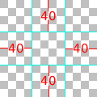
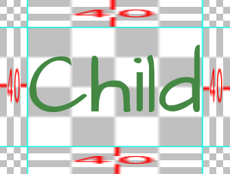
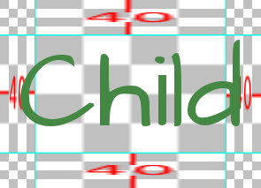
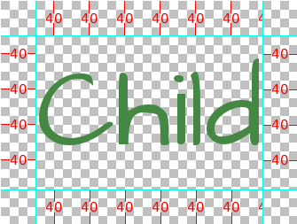

.. _gui:

============================
Руководство по настройке GUI
============================

.. ifconfig:: not renpy_figures

    .. note::

        В этой версии документации изображения опущены для экономии места.
        Чтобы просмотреть полную версию, посетите
        https://www.renpy.org/doc/html/gui.html

Ren'Py оснащен системой графического интерфейса пользователя (GUI), которая (как мы надеемся)
выглядит привлекательно «из коробки», может быть в некоторой степени настроена
и при необходимости полностью заменена. На этой странице объясняется, как выполнять
настройку GUI простого и среднего уровня сложности.

Информацию о более глубокой настройке см. в документации по
:doc:`стилям <style>` (включая список :doc:`свойств стилей <style_properties>`)
и :doc:`экранам <screens>` (включая :doc:`действия экранов <screen_actions>`
и :doc:`специальные экраны <screen_special>`).

Предполагается, что вы используете GUI Ren'Py нового образца (содержащийся в файле
:file:`gui.rpy`). Более старые варианты GUI (использующие файл :file:`screens.rpy`)
в контексте данного руководства следует рассматривать как продвинутую настройку GUI.

Простая настройка GUI
=====================

Существует несколько простых настроек GUI, имеющих смысл практически для
любой визуальной новеллы. Общим для этих настроек является то, что они не требуют
редактирования :file:`gui.rpy`. Они в определенной степени меняют GUI, но не меняют
кардинально его внешний вид.

Изменение размера и цветовой схемы
----------------------------------

Самое простое изменение в GUI — это изменение разрешения и цвета. Ren'Py предлагает
сделать этот выбор при первом создании проекта, однако пункт «Изменить/обновить GUI»
(Change/Update GUI) в лаунчере позволяет изменить ваш выбор в любое время.

При изменении GUI через лаунчер Ren'Py спросит, хотите ли вы просто изменить лаунчер
или обновить :file:`gui.rpy`. Оба варианта перезапишут большинство файлов изображений,
а перезапись :file:`gui.rpy` приведет к потере всех изменений, внесенных в этот файл.

Поэтому рекомендуется выполнять этот шаг до любой другой настройки.

Ren'Py запросит разрешение проекта по умолчанию, а затем цветовую схему для использования.
После выбора лаунчер обновит GUI в соответствии с вашими предпочтениями.

Файл options.rpy
----------------

В файле :file:`options.rpy` есть несколько переменных, используемых GUI.

:var:`config.name`
    Строка, содержащая понятное человеку название игры. Она используется в качестве
    заголовка окна и во всем GUI везде, где требуется название игры.

:var:`gui.show_name`
    Следует установить в значение False, чтобы скрыть название и номер версии
    из главного меню (например, если название уже нанесено на фоновое изображение
    главного меню).

:var:`config.version`
    Строка, задающая версию игры. Она отображается пользователю в различных местах
    стандартного GUI. Помимо этого, она используется и в других целях, например
    в сообщениях об ошибках или трассировках стека.

:var:`gui.about`
    Дополнительный текст, добавляемый на экран «Об игре» (about). Если вы хотите
    разделить благодарности на несколько абзацев, для их разделения можно использовать \\n\\n.

Вот пример определения этих переменных::

    define config.name = _('Старшая школа старой закалки')

    define gui.show_name = True

    define config.version = "1.0"

    define gui.about = _("Создано PyTom.\n\nФоны школы от Mugenjohncel.")

Для удобства имеет смысл определять gui.about с помощью многострочной строки в тройных
кавычках — в этом случае переносы строк сохраняются автоматически. ::

    define gui.about = _("""\
    Создано PyTom.

    Фоны школы от Mugenjohncel.""")

Фоновые изображения главного и игрового меню
--------------------------------------------

Изображения, используемые GUI, находятся в каталоге game/gui,
который можно открыть, выбрав «Открыть папку: gui» в лаунчере.
Основными файлами являются:

gui/main_menu.png
    Файл, содержащий изображение, используемое в качестве фона всех экранов
    главного меню.

gui/game_menu.png
    Файл, содержащий изображение, используемое в качестве фона всех экранов
    игрового меню.

.. ifconfig:: renpy_figures

    .. figure:: gui/easy_main_menu.jpg
        :width: 100%

        Главное меню, в котором заменен только файл :file:`gui/main_menu.png`.

    .. figure:: gui/easy_game_menu.jpg
        :width: 100%

        Экран «Об игре» может быть частью игрового меню (используя в качестве фона
        :file:`gui/game_menu.png`) или главного меню (используя в качестве фона
        :file:`gui/main_menu.png`). Для обоих можно установить одно и то же изображение.

Иконка окна
-----------

Иконка окна — это значок, который отображается запущенным приложением (в таких
местах, как панель задач Windows и док macOS).

Иконку окна можно изменить, заменив файл :file:`gui/window_icon.png`.

Обратите внимание, что это изменяет только значок, используемый запущенной игрой.
О том, как изменить значок файлов .exe в Windows и приложений macOS, см. в
:ref:`документации по сборке <special-files>`.

Настройка GUI средней сложности
===============================

Далее мы продемонстрируем промежуточный уровень настройки GUI. На этом уровне
можно изменять цвета, шрифты и изображения, используемые игрой. В целом,
настройка средней сложности сохраняет экраны в основном неизменными, с кнопками
и полосами на тех же местах, хотя изменение экранов для добавления новой
функциональности, безусловно, возможно.

Многие из этих изменений требуют редактирования переменных в :file:`gui.rpy`. Например,
чтобы увеличить размер шрифта диалога, найдите строку вида::

    define gui.text_size = 22

и увеличьте или уменьшите значение, например, до::

    define gui.text_size = 20

Обратите внимание, что значения по умолчанию часто отличаются от приведенных в этой
документации. Значения по умолчанию зависят от разрешения и цветов, выбранных для игры,
а значения в этом руководстве служат примером обширной настройки GUI. Лучше всего
искать в :file:`gui.rpy` оператор define и интересующую переменную — например,
``define gui.text_size``.

Некоторые из приведенных ниже настроек частично или полностью влияют на файлы
изображений. В результате изменения вступают в силу только тогда, когда обновляются
сами файлы изображений, что можно сделать, выбрав «Изменить GUI» (Change GUI)
в лаунчере и дав команду на повторную генерацию файлов изображений. (Но помните,
что это перезапишет любые файлы изображений, которые вы уже изменили.)

Возможно, имеет смысл подождать, пока игра не будет почти завершена, прежде чем
настраивать :file:`gui.rpy` подобным образом. Хотя старые файлы :file:`gui.rpy` работают
в новых версиях Ren'Py, новые файлы :file:`gui.rpy` могут содержать функции и исправления,
отсутствующие в старых версиях. Ранняя модификация GUI может затруднить использование
таких улучшений.

Диалог
------

Существует ряд относительно простых настроек, позволяющих изменить способ
отображения диалога игроку. Первая из них — замена текстового окна (текстбокса).

gui/textbox.png
    Этот файл содержит фон текстового окна, отображаемого как часть экрана say.
    Хотя он должен быть во всю ширину игры, текст отображается только в центральных
    60% экрана с отступами по 20% с каждой стороны.

Кроме того, существует ряд переменных, которые можно настроить для изменения диалога.

.. var:: gui.text_color = "#402000"

    Устанавливает цвет текста диалога.

.. var:: gui.text_font = "ArchitectsDaughter.ttf"

    Задает шрифт, используемый для текста диалога, меню, полей ввода и другого
    внутриигрового текста. Файл шрифта должен находиться в каталоге game.

.. var:: gui.text_size = 33

    Задает размер текста диалога. Может потребоваться увеличить или уменьшить его,
    чтобы выбранный шрифт поместился в отведенное пространство.

.. var:: gui.name_text_size = 45

    Задает размер имен персонажей.

По умолчанию метка имени персонажа использует цвет акцента (accent color). Этот
цвет можно легко изменить при определении персонажа::

    define e = Character("Эйлин", who_color="#104010")

.. ifconfig:: renpy_figures

    .. figure:: oshs/game/gui/textbox.png
        :width: 100%

        Пример изображения текстового окна.

    .. figure:: gui/easy_say_screen.jpg
        :width: 100%

        Диалог, настроенный с помощью изображения текстового окна и параметров
        переменных, приведенных выше.

Меню выбора
-----------

Экран choice используется оператором menu для отображения вариантов выбора игроку.
Здесь также есть несколько простых настроек, которые можно выполнить для экрана
выбора. В первую очередь это два файла изображений:

gui/button/choice_idle_background.png
    Это изображение используется в качестве фона кнопок выбора, когда они не находятся
    в фокусе.

gui/button/choice_hover_background.png
    Это изображение используется в качестве фона кнопок выбора при наведении фокуса.

По умолчанию текст располагается в центральных 75% этих изображений. Есть также
пара переменных, управляющих цветом текста на кнопках выбора.

.. var:: gui.choice_button_text_idle_color = '#888888'

    Цвет текста неактивных (не в фокусе) кнопок выбора.

.. var:: gui.choice_button_text_hover_color = '#0066cc'

    Цвет текста кнопок выбора при наведении курсора.

Этого должно быть достаточно для простой настройки, когда размер изображений не
требуется изменять. Для более сложных настроек обратитесь к разделу кнопок ниже.

.. ifconfig:: renpy_figures

    .. figure:: oshs/game/gui/button/choice_idle_background.png
        :width: 100%

        Пример изображения :file:`gui/button/idle_background.png`.

    .. figure:: oshs/game/gui/button/choice_hover_background.png
        :width: 100%

        Пример изображения :file:`gui/button/choice_hover_background.png`.

    .. figure:: gui/easy_choice_screen.jpg
        :width: 100%

        Пример экрана выбора, настроенного с использованием изображений и параметров
        переменных, приведенных выше.

Изображения наложения (оверлеи)
-------------------------------

Также имеется пара изображений наложения. Они используются для затемнения или
осветления фонового изображения, чтобы сделать кнопки и другие компоненты
пользовательского интерфейса более читаемыми. Эти изображения находятся в каталоге overlay:

gui/overlay/main_menu.png
    Наложение, используемое экраном главного меню.

gui/overlay/game_menu.png
    Наложение, используемое экранами игрового меню, включая экраны сохранения,
    загрузки, настроек, «Об игре», справки и т. д. Это наложение выбирается
    соответствующим экраном и используется даже при открытии из главного меню.

gui/overlay/confirm.png
    Наложение, используемое на экране подтверждения для затемнения фона.

.. ifconfig:: renpy_figures

    Вот пара примеров изображений наложения и то, как выглядит игра с добавленными
    изображениями наложения.

    .. figure:: oshs/game/gui/overlay/main_menu.png
        :width: 100%

        Пример изображения :file:`gui/overlay/main_menu.png`.

    .. figure:: oshs/game/gui/overlay/game_menu.png
        :width: 100%

        Пример изображения :file:`gui/overlay/game_menu.png`.

    .. figure:: gui/overlay_main_menu.jpg
        :width: 100%

        Главное меню после изменения наложений.

    .. figure:: gui/overlay_game_menu.jpg
        :width: 100%

        Игровое меню после изменения наложений.

Цвета, шрифты и размеры шрифтов
-------------------------------

Существует ряд переменных GUI, с помощью которых можно изменять цвет, шрифт
и размер текста.

.. raw:: html

   
Эти переменные обычно должны быть шестнадцатеричными кодами цвета — строками
   вида "#rrggbb" (или "#rrggbbaa" для задания компонента прозрачности), аналогично
   кодам цветов в веб-браузерах. Например, "#663399" — это код оттенка
   <a href="http://www.economist.com/blogs/babbage/2014/06/digital-remembrance" style="text-decoration: none; color: rebeccapurple">purple</a>.
   В интернете есть множество инструментов, позволяющих генерировать HTML-коды цветов,
   например, <a href="http://htmlcolorcodes.com/color-picker/">этот</a>.

Помимо описанных выше :var:`gui.text_color`, :var:`gui.choice_idle_color` и :var:`gui.choice_hover_color`,
существуют следующие переменные:

.. var:: gui.accent_color = '#000060'

    Цвет акцента используется во многих местах GUI, включая заголовки и метки.

.. var:: gui.idle_color = '#606060'

    Цвет большинства кнопок, когда на них не наведен курсор и они не выбраны.

.. var:: gui.idle_small_color = '#404040'

    Цвет для мелкого текста (такого как дата и имя слота сохранения, а также
    кнопки быстрого меню) в пассивном состоянии. Этот цвет часто должен быть
    немного светлее или темнее idle_color, чтобы компенсировать меньший размер шрифта.

.. var:: gui.hover_color = '#3284d6'

    Цвет элементов в фокусе, включая текст кнопок и ползунки (подвижные области)
    слайдеров и полос прокрутки.

.. var:: gui.selected_color = '#555555'

    Цвет текста выбранных кнопок. (Имеет приоритет над hover_color и idle_color.)

.. var:: gui.insensitive_color = '#8888887f'

    Цвет текста кнопок, нечувствительных к пользовательскому вводу (например,
    кнопка отката, когда откат невозможен).

.. var:: gui.interface_text_color = '#404040'

    Цвет статического текста в интерфейсе игры, например текста на экранах
    справки и сведений об игре.

.. var:: gui.muted_color = '#6080d0'
.. var:: gui.hover_muted_color = '#8080f0'

    Приглушенные цвета, используемые для областей полос, полос прокрутки и слайдеров,
    которые не представляют значение или видимую область. (Они используются только
    при генерации изображений и не вступят в силу до перегенерации изображений
    в лаунчере.)

Помимо :var:`gui.text_font`, следующие переменные выбирают шрифты для текста.
Эти шрифты также должны быть помещены в каталог game.

.. var:: gui.interface_text_font = "ArchitectsDaughter.ttf"

    Шрифт, используемый для текста элементов интерфейса пользователя, таких как
    главное и игровое меню, кнопки и т. д.

.. var:: gui.system_font = "DejaVuSans.ttf"

    Шрифт для системного текста, такого как сообщения об исключениях и меню
    специальных возможностей Shift+A. Он должен поддерживать как ASCII, так и
    символы языка перевода игры.

.. var:: gui.glyph_font = "DejaVuSans.ttf"

    Шрифт, используемый для определенных глифов, таких как стрелки индикатора
    пропуска. DejaVuSans — разумный выбор по умолчанию для этих глифов, и он
    автоматически включается в каждую игру Ren'Py.

Помимо :var:`gui.text_size` и :var:`gui.name_text_size`, следующие переменные
управляют размерами текста:

.. var:: gui.interface_text_size = 36

    Размер статического текста в интерфейсе пользователя игры и размер по умолчанию
    для текста кнопок в интерфейсе игры.

.. var:: gui.label_text_size = 45

    Размер меток разделов в пользовательском интерфейсе игры.

.. var:: gui.notify_text_size = 24

    Размер текста уведомлений.

.. var:: gui.title_text_size = 75

    Размер заголовка игры.

.. ifconfig:: renpy_figures

    .. figure:: gui/text.jpg
        :width: 100%

        Игровое меню после настройки цветов, шрифтов и размеров текста.

Границы (Borders)
-----------------

Ряд компонентов GUI — таких как кнопки и полосы — используют масштабируемые
фоны, настраиваемые с помощью объектов Borders. Прежде чем обсуждать настройку
кнопок и полос, мы сначала опишем, как это работает.

Границы передаются отображаемому объекту :func:`Frame`.
Frame берет изображение и делит его на девять частей: четыре угла, четыре стороны
и центр. Углы всегда сохраняют свой исходный размер, левая и правая стороны растягиваются
по вертикали, верхняя и нижняя — по горизонтали, а центр растягивается в обоих направлениях.

Объект Borders задает размер каждой границы в порядке: левая, верхняя, правая, нижняя.
Поэтому, если используется следующее изображение границы:

в сочетании со следующими границами::

    Borders(40, 40, 40, 40)

одним из возможных результатов будет:

По мере изменения размера дочернего элемента меняется и размер фона.

Объекту Border также можно задать внутренние отступы (padding), включая отрицательные
значения отступов, из-за которых дочерний элемент перекрывает границы. Например,
следующие границы::

    Borders(40, 40, 40, 40, -20, -20, -20, -20)

позволяют дочернему элементу перекрывать стороны. Обратите внимание, что из-за этого
перекрытия результат оказывается меньше, так как сами границы теперь занимают меньше места.

Границы также могут быть мозаичными (tiled), а не растягиваемыми (scaled). Это задается
переменными и дает следующий результат:

Эти примеры выглядят схематично, так как их задача — продемонстрировать принцип работы.
На практике эта система позволяет получать весьма привлекательные результаты. Именно
так отображаемый объект Frame используется в качестве фона окон фреймов, содержащих
компоненты пользовательского интерфейса.

Такие окна фреймов можно настраивать двумя способами. Во-первых, изменив файл
фонового изображения:

gui/frame.png
    Изображение, используемое в качестве фона окон фреймов.

И во-вторых, путем настройки переменных:

.. var:: gui.frame_borders = Borders(15, 15, 15, 15)

    Границы, применяемые к окнам фреймов.

.. var:: gui.confirm_frame_borders = Borders(60, 60, 60, 60)

    Границы, применяемые к фрейму на экране подтверждения.

.. var:: gui.frame_tile = True

    Если True, стороны и центр экрана подтверждения заполняются мозаикой. Если False,
    они масштабируются.

.. ifconfig:: renpy_figures

    .. figure:: oshs/game/gui/frame.png
        :width: 100%

        Пример изображения :file:`gui/frame.png`.

    .. figure:: gui/frame_confirm.jpg
        :width: 100%

        Экран подтверждения после применения приведенных выше настроек.

Кнопки
------

Интерфейс пользователя Ren'Py включает в себя большое количество кнопок, имеющих
различные размеры и используемых для разных целей. Существуют следующие типы кнопок:

button
    Базовая кнопка. Используется для навигации в пользовательском интерфейсе.

choice_button
    Кнопка, используемая для вариантов выбора во внутриигровом меню.

quick_button
    Кнопка, отображаемая в игре и предназначенная для быстрого доступа к игровому меню.

navigation_button
    Кнопка, используемая в главном и игровом меню для навигации между экранами
    и для запуска игры.

page_button
    Кнопка, используемая для переключения между страницами на экранах сохранения и загрузки.

slot_button
    Кнопки, представляющие слоты сохранения и содержащие миниатюру, время сохранения
    и необязательное имя сохранения. Более подробно они описаны ниже.

radio_button
    Кнопка, используемая для настроек с множественным выбором на экране настроек.

check_button
    Кнопка, используемая для переключаемых настроек (флажков) на экране настроек.

test_button
    Кнопка для проверки воспроизведения звука на экране настроек. Она должна иметь
    ту же высоту, что и горизонтальный слайдер.

help_button
    Кнопка, используемая для выбора раздела справки.

confirm_button
    Кнопка, используемая на экране подтверждения для выбора «да» или «нет».

nvl_button
    Кнопка, используемая для пунктов меню в режиме NVL.

Следующие файлы изображений используются для настройки фона кнопок, если они существуют:

gui/button/idle_background.png
    Фоновое изображение кнопок, не находящихся в фокусе.

gui/button/hover_background.png
    Фоновое изображение кнопок под курсором (в фокусе).

gui/button/selected_idle_background.png
    Фоновое изображение выбранных кнопок, не находящихся в фокусе. Это изображение
    необязательно; если оно существует, оно используется вместо :file:`idle_background.png`.

gui/button/selected_hover_background.png
    Фоновое изображение выбранных кнопок под курсором. Необязательно; если существует,
    используется вместо :file:`hover_background.png`.

Для каждого типа кнопки можно задать более конкретные фоны, добавив имя типа
в качестве префикса. Например, :file:`gui/button/check_idle_background.png` используется
в качестве фона неактивных флажков (check buttons).

Четыре файла изображений используются в качестве декоративных элементов переднего плана
на переключателях (radio) и флажках (check), показывая, выбран параметр или нет:

gui/button/check_foreground.png, gui/button/radio_foreground.png
    Эти изображения используются, когда кнопка-флажок или переключатель не выбраны.

gui/button/check_selected_foreground.png, gui/button/radio_selected_foreground.png
    Эти изображения используются, когда кнопка-флажок или переключатель выбраны.

Следующие переменные задают различные свойства кнопок:

.. var:: gui.button_width = None
.. var:: gui.button_height = 64

    Ширина и высота кнопки в пикселях. Если None, размер определяется автоматически
    на основе размера текста внутри кнопки и указанных ниже границ.

.. var:: gui.button_borders = Borders(10, 10, 10, 10)

    Границы вокруг кнопки в порядке: левая, верхняя, правая, нижняя.

.. var:: gui.button_tile = True

    Если True, стороны и центр фона кнопки заполняются мозаикой при изменении
    размера. Если False, стороны и центр масштабируются.

.. var:: gui.button_text_font = gui.interface_font
.. var:: gui.button_text_size = gui.interface_text_size

    Шрифт и размер текста кнопки.

.. var:: gui.button_text_idle_color = gui.idle_color
.. var:: gui.button_text_hover_color = gui.hover_color
.. var:: gui.button_text_selected_color = gui.accent_color
.. var:: gui.button_text_insensitive_color = gui.insensitive_color

    Цвет текста кнопки в различных состояниях.

.. var:: gui.button_text_xalign = 0.0

    Горизонтальное выравнивание текста кнопки: 0.0 — по левому краю, 0.5 — по центру,
    1.0 — по правому краю.

.. var:: gui.button_image_extension = ".png"

    Расширение для изображений кнопок. Можно изменить на .webp для использования
    изображений WEBP вместо PNG.

Эти переменные можно предварять именем типа кнопки для настройки свойства конкретного
типа. Например, :var:`gui.choice_button_text_idle_color` настраивает цвет текста
пассивной кнопки выбора.

Например, в нашей демонстрационной игре мы настраиваем следующие переменные:

.. var:: gui.navigation_button_width = 290

    Увеличивает ширину кнопок навигации.

.. var:: gui.radio_button_borders = Borders(40, 10, 10, 10)
.. var:: gui.check_button_borders = Borders(40, 10, 10, 10)

    Увеличивает ширину границ переключателей и флажков, оставляя дополнительное
    место слева для отметки выбора.

.. ifconfig:: renpy_figures

    Вот пример настройки игрового экрана:

    .. figure:: oshs/game/gui/button/idle_background.png

        Пример изображения :file:`gui/button/idle_background.png`.

    .. figure:: oshs/game/gui/button/hover_background.png

        Пример изображения :file:`gui/button/hover_background.png`.

    .. figure:: oshs/game/gui/button/check_foreground.png

        Изображение, которое можно использовать в качестве :file:`gui/button/check_foreground.png`
        и :file:`gui/button/radio_foreground.png`.

    .. figure:: oshs/game/gui/button/check_selected_foreground.png

        Изображение, которое можно использовать в качестве :file:`gui/button/check_selected_foreground.png`
        и :file:`gui/button/radio_selected_foreground.png`.

    .. figure:: gui/button_preferences.jpg
        :width: 100%

        Экран настроек с применением настроек, описанных в этом разделе.

Кнопки слотов сохранения
------------------------

На экранах загрузки и сохранения используются кнопки слотов, отображающие миниатюру
и информацию о времени сохранения файла. Следующие переменные очень удобны
для настройки размера слотов сохранения:

.. var:: gui.slot_button_width = 414
.. var:: gui.slot_button_height = 309

    Ширина и высота кнопки слота сохранения.

.. var:: gui.slot_button_borders = Borders(15, 15, 15, 15)

    Границы, применяемые к каждому слоту сохранения.

Переменные :var:`config.thumbnail_width` = 384 и :var:`config.thumbnail_height` = 216
задают ширину и высоту миниатюр сохранения. Обратите внимание, что они находятся в
пространстве имен config, а не gui. Изменения вступают в силу только при сохранении
и загрузке новых файлов.

.. var:: gui.file_slot_cols = 3
.. var:: gui.file_slot_rows = 2

    Количество столбцов и строк в сетке слотов сохранения.

Фоновые изображения для слотов сохранения:

gui/button/slot_idle_background.png
    Изображение фона слотов сохранения, не находящихся в фокусе.

gui/button/slot_hover_background.png
    Изображение фона слотов сохранения при наведении фокуса.

.. ifconfig:: renpy_figures

    Применяя их, получаем:

    .. figure:: oshs/game/gui/button/slot_idle_background.png

        Пример изображения :file:`gui/button/slot_idle_background.png`.

    .. figure:: oshs/game/gui/button/slot_hover_background.png

        Пример изображения :file:`gui/button/slot/slot_hover_background.png`.

    .. figure:: gui/slot_save.jpg

        Экран сохранения после применения настроек, приведенных в этом разделе.

Ползунки (слайдеры)
-------------------

Слайдеры — это разновидность полос, используемых на экране настроек, позволяющая
игроку настраивать параметры с широким диапазоном значений. По умолчанию GUI
использует только горизонтальные слайдеры, однако в игре могут применяться и вертикальные.

Слайдеры настраиваются с помощью следующих изображений:

gui/slider/horizontal_idle_bar.png, gui/slider/horizontal_hover_bar.png, gui/slider/vertical_idle_bar.png, gui/slider/vertical_hover_bar.png
    Изображения, используемые для фона вертикальных и горизонтальных полос
    в обычном состоянии и при наведении курсора.

gui/slider/horizontal_idle_thumb.png, gui/slider/horizontal_hover_thumb.png, gui/slider/vertical_idle_thumb.png, gui/slider/vertical_hover_thumb.png
    Изображения, используемые для бегунка (thumb) — подвижной части полосы.

Также используются следующие переменные:

.. var:: gui.slider_size = 64

    Высота горизонтальных слайдеров и ширина вертикальных слайдеров.

.. var:: gui.slider_tile = True

    Если True, фрейм, содержащий полосу слайдера, заполняется мозаикой. Если False,
    он масштабируется.

.. var:: gui.slider_borders = Borders(6, 6, 6, 6)
.. var:: gui.vslider_borders = Borders(6, 6, 6, 6)

    Границы, используемые с объектом Frame, содержащим изображение полосы.

.. ifconfig:: renpy_figures

    Вот пример настройки горизонтального слайдера:

    .. figure:: oshs/game/gui/slider/horizontal_idle_bar.png

        Пример изображения :file:`gui/slider/horizontal_idle_bar.png`.

    .. figure:: oshs/game/gui/slider/horizontal_hover_bar.png

        Пример изображения :file:`gui/slider/horizontal_hover_bar.png`.

    .. figure:: oshs/game/gui/slider/horizontal_idle_thumb.png

        Пример изображения :file:`gui/slider/horizontal_idle_thumb.png`.

    .. figure:: oshs/game/gui/slider/horizontal_hover_thumb.png

        Пример изображения :file:`gui/slider/horizontal_hover_thumb.png`.

    .. figure:: gui/slider_preferences.jpg
        :width: 100%

        Экран настроек после применения настроек, приведенных в этом разделе.

Полосы прокрутки
----------------

Полосы прокрутки (скроллбары) используются для прокрутки областей просмотра (viewports).
В стандартном GUI наиболее заметным местом применения полосы прокрутки является экран истории,
однако вертикальные скроллбары могут использоваться и на других экранах.

Полосы прокрутки настраиваются с помощью следующих изображений:

gui/scrollbar/horizontal_idle_bar.png, gui/scrollbar/horizontal_hover_bar.png, gui/scrollbar/vertical_idle_bar.png, gui/scrollbar/vertical_hover_bar.png
    Изображения фона горизонтальных и вертикальных полос в обычном состоянии
    и при наведении курсора.

gui/scrollbar/horizontal_idle_thumb.png, gui/scrollbar/horizontal_hover_thumb.png, gui/scrollbar/vertical_idle_thumb.png, gui/scrollbar/vertical_hover_thumb.png
    Изображения для бегунка — подвижной части полосы прокрутки.

Также используются следующие переменные:

.. var:: gui.scrollbar_size = 24

    Высота горизонтальных полос прокрутки и ширина вертикальных полос прокрутки.

.. var:: gui.scrollbar_tile = True

    Если True, фрейм полосы прокрутки заполняется мозаикой. Если False, он масштабируется.

.. var:: gui.scrollbar_borders = Borders(10, 6, 10, 6)
.. var:: gui.vscrollbar_borders = Borders(6, 10, 6, 10)

    Границы, используемые с фреймом, содержащим изображение полосы.

.. var:: gui.unscrollable = "hide"

    Определяет поведение, когда полоса не может прокручиваться. "hide" скрывает
    полосу, а None оставляет ее видимой.

.. ifconfig:: renpy_figures

    Вот пример настройки вертикальной полосы прокрутки:

    .. figure:: oshs/game/gui/scrollbar/vertical_idle_bar.png
        :height: 150

        Пример изображения :file:`gui/scrollbar/vertical_idle_bar.png`.

    .. figure:: oshs/game/gui/scrollbar/vertical_hover_bar.png
        :height: 150

        Пример изображения :file:`gui/scrollbar/vertical_hover_bar.png`.

    .. figure:: oshs/game/gui/scrollbar/vertical_idle_thumb.png
        :height: 150

        Пример изображения :file:`gui/scrollbar/vertical_idle_thumb.png`.

    .. figure:: oshs/game/gui/scrollbar/vertical_hover_thumb.png
        :height: 150

        Пример изображения :file:`gui/scrollbar/vertical_hover_thumb.png`.

    .. figure:: gui/scrollbar_history.jpg
        :width: 100%

        Экран истории после применения настроек, приведенных в этом разделе.

Полосы прогресса (бары)
-----------------------

Обычные полосы (bars) используются для отображения численных значений игроку.
Они не задействованы в базовом GUI, но могут использоваться в экранах, созданных разработчиком.

Полосу можно настроить, изменив следующие изображения:

gui/bar/left.png, gui/bar/bottom.png
    Изображения, используемые для заполненной части горизонтальных и вертикальных полос.

gui/bar/right.png, gui/bar/top.png
    Изображения, используемые для незаполненной части горизонтальных и вертикальных полос.

Также доступны стандартные переменные для управления полосами:

.. var:: gui.bar_size = 64

    Высота горизонтальных полос и ширина вертикальных полос.

.. var:: gui.bar_tile = False

    Если True, изображения полосы заполняются мозаикой. Если False, они линейно
    масштабируются.

.. var:: gui.bar_borders = Borders(10, 10, 10, 10)
.. var:: gui.vbar_borders = Borders(10, 10, 10, 10)

    Границы, используемые с фреймами, содержащими изображения полос.

.. ifconfig:: renpy_figures

    Вот пример настройки горизонтальных полос:

    .. figure:: oshs/game/gui/bar/left.png
        :width: 100%

        Пример изображения :file:`gui/bar/left.png`.

    .. figure:: oshs/game/gui/bar/right.png
        :width: 100%

        Пример изображения :file:`gui/bar/right.png`.

    .. figure:: gui/bar.jpg
        :width: 100%

        Созданный нами экран в качестве примера полосы.

Индикаторы пропуска и уведомления
---------------------------------

Экраны пропуска (skip) и уведомлений (notify) отображают фреймы с сообщениями.
Оба используют собственные фоновые изображения фреймов:

gui/skip.png
    Фон индикатора пропуска.

gui/notify.png
    Фон экрана уведомлений.

Управляющие переменные:

.. var:: gui.skip_frame_borders = Borders(24, 8, 75, 8)

    Границы фрейма, используемого экраном пропуска.

.. var:: gui.notify_frame_borders = Borders(24, 8, 60, 8)

    Границы фрейма, используемого экраном уведомлений.

.. var:: gui.skip_ypos = 15

    Положение индикатора пропуска по вертикали в пикселях от верхнего края окна.

.. var:: gui.notify_ypos = 68

    Положение сообщения уведомления по вертикали в пикселях от верхнего края окна.

.. ifconfig:: renpy_figures

    Вот пример настройки экранов пропуска и уведомлений:

    .. figure:: oshs/game/gui/skip.png
        :width: 100%

        Пример изображения :file:`gui/skip.png`.

    .. figure:: oshs/game/gui/notify.png
        :width: 100%

        Пример изображения :file:`gui/notify.png`.

    .. figure:: gui/skip_notify.jpg

        Экраны пропуска и уведомлений в действии.

Диалог (продолжение)
--------------------

В дополнение к простым настройкам, приведенным выше, существует множество
способов управлять отображением диалога для игрока.

Окно текста (текстбокс)
^^^^^^^^^^^^^^^^^^^^^^^

Текстовое окно (textbox или window) — это окно, в котором отображается диалог.
Помимо изменения файла gui/textbox.png, отображением окна управляют следующие переменные:

.. var:: gui.textbox_height = 278

    Высота текстового окна, которая также должна соответствовать высоте gui/textbox.png.

.. var:: gui.textbox_yalign = 1.0

    Размещение текстового окна по вертикали на экране: 0.0 — верх, 0.5 — центр,
    1.0 — низ.

Имя и окно имени (неймбокс)
^^^^^^^^^^^^^^^^^^^^^^^^^^^

Имя персонажа размещается внутри фрейма, фоном которого служит gui/namebox.png.
Кроме того, отображением имени управляет ряд переменных. Окно имени отображается
только в том случае, если у говорящего персонажа задано имя (пустое имя, например " ",
также считается).

.. var:: gui.name_xpos = 360
.. var:: gui.name_ypos = 0

    Положение имени и окна имени по горизонтали и вертикали. Обычно задаются числом
    пикселей от левого или верхнего края текстового окна. Значение 0.5 центрирует
    имя в текстовом окне (см. ниже). Эти значения могут быть отрицательными — например,
    установка gui.name_ypos в -22 размещает имя на 22 пикселя выше верхнего края текстового окна.

.. var:: gui.name_xalign = 0.0

    Горизонтальное выравнивание имени персонажа: 0.0 — по левому краю, 0.5 — по центру,
    1.0 — по правому краю (почти всегда используется 0.0 или 0.5). Используется как
    для позиционирования окна имени относительно gui.name_xpos, так и для выбора края
    окна имени, выравниваемого по xpos.

.. var:: gui.namebox_width = None
.. var:: gui.namebox_height = None
.. var:: gui.namebox_borders = Borders(5, 5, 5, 5)
.. var:: gui.namebox_tile = False

    Эти переменные управляют отображением фрейма, содержащего окно имени.

Текст диалога
^^^^^^^^^^^^^

.. var:: gui.dialogue_xpos = 402
.. var:: gui.dialogue_ypos = 75

    Положение текста диалога по горизонтали и вертикали. Обычно задаются числом
    пикселей от левого или верхнего края текстового окна. Значение 0.5 центрирует
    диалог в текстовом окне (см. ниже).

.. var:: gui.dialogue_width = 1116

    Максимальная ширина строки диалога в пикселях. При достижении этой ширины
    Ren'Py автоматически переносит текст на новую строку.

.. var:: gui.dialogue_text_xalign = 0.0

    Горизонтальное выравнивание текста диалога: 0.0 — по левому краю, 0.5 — по центру,
    1.0 — по правому краю.

Примеры
^^^^^^^

Чтобы отцентрировать имя персонажа, используйте::

    define gui.name_xpos = 0.5
    define gui.name_xalign = 0.5

Чтобы отцентрировать текст диалога, используйте::

    define gui.dialogue_xpos = 0.5
    define gui.dialogue_text_xalign = 0.5

В нашей примерной игре для настройки центрированного окна имени используются следующие строки::

    define gui.namebox_width = 300
    define gui.name_ypos = -22
    define gui.namebox_borders = Borders(15, 7, 15, 7)
    define gui.namebox_tile = True

.. ifconfig:: renpy_figures

    .. figure:: oshs/game/gui/namebox.png

        Пример изображения :file:`gui/namebox.png`.

    .. figure:: gui/intermediate_dialogue.jpg
        :width: 100%

        Примерная игра, настроенная с помощью параметров выше.

История (диалоговый лог)
------------------------

Отображением экрана истории управляют несколько переменных.

Переменная :var:`config.history_length`, по умолчанию равная 250, задает
количество блоков диалога, сохраняемых Ren'Py в истории.

.. var:: gui.history_height = 210

    Высота отдельной записи истории в пикселях. Может быть установлена в None,
    чтобы высота записи менялась адаптивно, однако это снижает производительность —
    при значении None может потребоваться существенно снизить config.history_length.

.. var:: gui.history_spacing = 0

    Расстояние между записями истории в пикселях.

.. var:: gui.history_name_xpos = 0.5
.. var:: gui.history_text_xpos = 0.5

    Положение метки имени и текста диалога по горизонтали. Задается числом пикселей
    от левого края записи истории или значением 0.5 для центрирования.

.. var:: gui.history_name_ypos = 0
.. var:: gui.history_text_ypos = 60

    Положение метки имени и текста диалога по вертикали относительно верхнего края
    записи истории в пикселях.

.. var:: gui.history_name_width = 225
.. var:: gui.history_text_width = 1110

    Ширина метки имени и текста диалога в пикселях.

.. var:: gui.history_name_xalign = 0.5
.. var:: gui.history_text_xalign = 0.5

    Управляет выравниванием текста и тем, какой край текста совмещается с xpos.
    0.0 — по левому краю, 0.5 — по центру, 1.0 — по правому краю.

.. ifconfig:: renpy_figures

    .. figure:: gui/history.png
        :width: 100%

        Экран истории, настроенный с помощью приведенных выше параметров.

Режим NVL
---------

Экран nvl отображает диалог в режиме NVL. Его можно настроить несколькими способами.
Первый способ — изменить фоновое изображение режима NVL:

gui/nvl.png
    Фоновое изображение, используемое в режиме NVL. Должно иметь тот же размер,
    что и окно игры.

Также для настройки отображения текста в режиме NVL используется ряд переменных:

.. var:: gui.nvl_borders = Borders(0, 15, 0, 30)

    Границы вокруг фона режима NVL. Поскольку фон не является фреймом, эти границы
    используются только в качестве внутренних отступов (padding), предотвращающих
    прилегание текста вплотную к краям экрана.

.. var:: gui.nvl_height = 173

    Высота отдельной записи в режиме NVL. Задание фиксированной высоты позволяет
    использовать режим NVL без разбиения на страницы, отображая фиксированное количество
    записей одновременно. Значение None позволяет записям иметь переменную высоту.

.. var:: gui.nvl_spacing = 15

    Интервал между записями, когда gui.nvl_height равно None, а также расстояние
    между кнопками меню в режиме NVL.

.. var:: gui.nvl_name_xpos = 0.5
.. var:: gui.nvl_text_xpos = 0.5
.. var:: gui.nvl_thought_xpos = 0.5

    Позиционирование имен персонажей, текста диалога и текста мыслей/повествования
    относительно левого края записи. Может быть числом пикселей или значением 0.5 для
    центрирования.

.. var:: gui.nvl_name_xalign = 0.5
.. var:: gui.nvl_text_xalign = 0.5
.. var:: gui.nvl_thought_xalign = 0.5

    Выравнивание текста. Определяет как выравнивание текста, так и край, совмещаемый
    с xpos: 0.0 — по левому краю, 0.5 — по центру, 1.0 — по правому краю.

.. var:: gui.nvl_name_ypos = 0
.. var:: gui.nvl_text_ypos = 60
.. var:: gui.nvl_thought_ypos = 0

    Положение имен персонажей, текста диалога и текста мыслей/повествования
    относительно верхнего края записи в пикселях.

.. var:: gui.nvl_name_width = 740
.. var:: gui.nvl_text_width = 740
.. var:: gui.nvl_thought_width = 740

    Ширина каждого типа текста в пикселях.

.. var:: gui.nvl_button_xpos = 0.5
.. var:: gui.nvl_button_xalign = 0.5

    Положение и выравнивание кнопок меню режима NVL.

По умолчанию Ren'Py не использует режим NVL. Он активируется через персонажей режима NVL
и определение нескольких переменных в :file:`script.rpy`. ::

    define e = Character("Эйлин", kind=nvl)
    define narrator = nvl_narrator
    define menu = nvl_menu

.. ifconfig:: renpy_figures

    Вот пример экрана NVL, настроенного с использованием параметров выше:

    .. figure:: oshs/game/gui/nvl.png

        Пример изображения :file:`gui/nvl.png`.

    .. figure:: gui/nvl.jpg
        :width: 100%

        Примерная игра, настроенная с помощью параметров выше.

Текст
-----

Большую часть текста можно настроить с помощью переменных GUI. Используемые
переменные имеют вид:

.. var:: gui.kind_text_font

    Шрифт текста (если задан).

.. var:: gui.kind_text_size

    Размер текста (если задан).

.. var:: gui.kind_text_color

    Цвет текста (если задан).

Другие :ref:`свойства стиля текста <text-style-properties>` также можно задавать
подобным образом. Например, gui.kind_text_outlines устанавливает свойство
:propref:`outlines`.

Префикс `kind` можно опустить — в этом случае настраивается вид текста по умолчанию.
В противном случае это может быть один из приведенных выше типов кнопок либо один из следующих:

interface
    Для текста по умолчанию во внеигровом интерфейсе.

input
    Для текста в виджете ввода текста.

input_prompt
    Для части приглашения (prompt) в поле ввода текста.

label
    Для декоративных меток.

prompt
    Для запросов подтверждения, задающих вопрос игроку.

name
    Для имен персонажей.

dialogue
    Для текста диалога.

notify
    Для текста всплывающих уведомлений.

Например::

    define gui.dialogue_text_outlines = [ (0, "#00000080", 2, 2) ]

добавляет полупрозрачную тень справа снизу от текста диалога.

Перевод и переменные GUI
------------------------

Пространство имен gui уникально тем, что оно сохраняется после фазы инициализации,
но перед выполнением любых блоков ``translate python``. Это дает возможность
изменять любые переменные GUI в блоке ``translate python`` для адаптации под другой
язык. Например, следующий код изменяет шрифт и размер текста по умолчанию: ::

    translate japanese python:
        gui.text_font = "MTLc3m.ttf"
        gui.text_size = 24

Есть одна особенность, о которой следует знать переводчикам: в некоторых местах
:file:`gui.rpy` значение одной переменной присваивается другой. Например, в стандартном
:file:`gui.rpy` указано::

    define gui.interface_text_font = "DejaVuSans.ttf"

а далее по тексту::

    define gui.button_text_font = gui.interface_text_font

Поскольку оба эти оператора выполняются до запуска любых блоков ``translate``,
необходимо переопределять обе переменные: ::

    translate japanese python:

        gui.interface_text_font = "MTLc3m.ttf"
        gui.button_text_font = "MTLc3m.ttf"

Если бы второй оператор отсутствовал, для кнопок по-прежнему использовался бы DejaVuSans.

.. _more_advanced_gui:

Продвинутая настройка
=====================

Более глубокая настройка возможна за счет изменения :file:`screens.rpy`,
вплоть до полного удаления содержимого файла и замены его собственным кодом.
Вот несколько отправных точек для начала работы.

Стили
-----

:doc:`Стили <style>` и :doc:`свойства стилей <style_properties>` управляют тем, как отображаются
отображаемые объекты. Чтобы узнать, какой стиль использует объект, наведите на него мышь
и нажмите Shift+I. Это вызовет инспектор стилей, отображающий имена стилей. Зная имя
стиля, можно использовать оператор style для его настройки.

Например, предположим, что мы решили выделить текст диалога ярко-красным контуром.
Наведем мышь на текст и нажмем Shift+I: мы увидим, что используется стиль с именем
say_dialogue. Теперь мы можем добавить (в конец файла :file:`screens.rpy` или где-либо
в :file:`options.rpy`) следующий оператор стиля::

    style say_dialogue:
        outlines [ (1, "#f00", 0, 0 ) ]

С помощью операторов style возможно колоссальное количество настроек интерфейса.

Экраны — Навигация
------------------

Следующий уровень настройки — модификация экранов. Наиболее важная документация
по экранам находится в разделах :doc:`screens` и :doc:`screen_actions`.

Один из важнейших экранов — экран навигации (navigation), который служит как
главным меню, так и меню навигации игрового меню. Этот экран можно редактировать,
добавляя новые кнопки в одно или оба меню. Например, изменив экран навигации на::

    screen navigation():

        vbox:
            style_prefix "navigation"

            xpos gui.navigation_xpos
            yalign 0.5

            spacing gui.navigation_spacing

            if main_menu:

                textbutton _("Начать") action Start()

                textbutton _("Пролог") action Start("prologue")

            else:

                textbutton _("Кодекс") action ShowMenu("codex")

                textbutton _("История") action ShowMenu("history")

                textbutton _("Сохранить") action ShowMenu("save")

            textbutton _("Загрузить") action ShowMenu("load")

            textbutton _("Настройки") action ShowMenu("preferences")

            if _in_replay:

                textbutton _("Завершить повтор") action EndReplay(confirm=True)

            elif not main_menu:

                textbutton _("Главное меню") action MainMenu()

            textbutton _("Об игре") action ShowMenu("about")

            textbutton _("Дополнительно") action ShowMenu("extras")

            if renpy.variant("pc"):

                textbutton _("Помощь") action ShowMenu("help")

                textbutton _("Выход") action Quit(confirm=not main_menu)

Мы добавили доступ к экрану пролога из главного меню, к экрану кодекса из игрового меню
и к экрану дополнительных материалов из обоих меню.

Экраны — Игровое меню
---------------------

Также можно создавать собственные экраны игрового меню. Такие экраны могут использовать
экран game_menu для формирования заголовка и прокручиваемой области просмотра. Минимальный
пользовательский экран игрового меню выглядит следующим образом::

    screen codex():

        tag menu

        use game_menu(_("Кодекс"), scroll="viewport"):

            style_prefix "codex"

            has vbox:
                spacing 20

            text _("{b}Машиностроение:{/b} где учат создавать ракеты и бомбы.")

            text _("{b}Гражданское строительство:{/b} где учат строить мишени.")

Разумеется, функциональный кодекс потребует более детальной проработки.

Обратите внимание на строку "tag menu". Эта строка крайне важна: она скрывает другие
экраны меню при открытии кодекса. Без нее было бы сложно переключаться между экранами меню.

Экраны — Клик для продолжения (CTC)
-----------------------------------

Часто в игру добавляют экран «клик для продолжения» (click to continue, CTC). Это
экран, отображаемый после того, как завершился вывод текста на экран. Простой пример::

    screen ctc(arg=None):

        frame:
            at ctc_appear
            xalign .99
            yalign .99

            text _("(нажмите для продолжения)"):
                size 18

    transform ctc_appear:
        alpha 0.0
        pause 5.0
        linear 0.5 alpha 1.0

Этот экран ctc использует трансформацию, отображающую фрейм через 5 секунд.
Рекомендуется задерживать появление анимации CTC на несколько секунд, чтобы дать
Ren'Py время предзагрузить изображения.

Полная замена GUI
-----------------

Опытные авторы могут полностью или частично заменить содержимое :file:`screens.rpy`.
При этом часть содержимого :file:`gui.rpy` или весь файл могут стать избыточными.
Хорошей идеей является вызов :func:`gui.init` для сброса стилей — после этого разработчик
может реализовать любую необходимую структуру. Как правило, имеет смысл включить
некоторые или все :doc:`специальные экраны <screen_special>`, чтобы игроки сохранили
доступ ко всей полноте функциональности, предоставляемой Ren'Py.

См. также
=========

Дополнительную информацию о GUI см. в разделе :doc:`Продвинутый GUI <gui_advanced>`.

.. _gui-changes:

Несовместимые изменения GUI
===========================

По мере развития GUI имена некоторых переменных иногда меняются. Эти изменения
вступают в силу только при повторной генерации GUI — до тех пор игра будет продолжать
использовать старые имена переменных в новой версии Ren'Py.

6.99.12.3
---------

* gui.default_font -> gui.text_font
* gui.name_font -> gui.name_text_font
* gui.interface_font -> gui.interface_text_font
* gui.text_xpos -> gui.dialogue_xpos
* gui.text_ypos -> gui.dialogue_ypos
* gui.text_width -> gui.dialogue_width
* gui.text_xalign -> gui.dialogue_text_xalign
